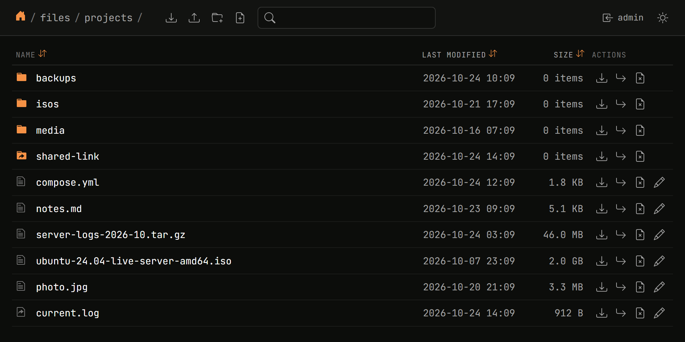
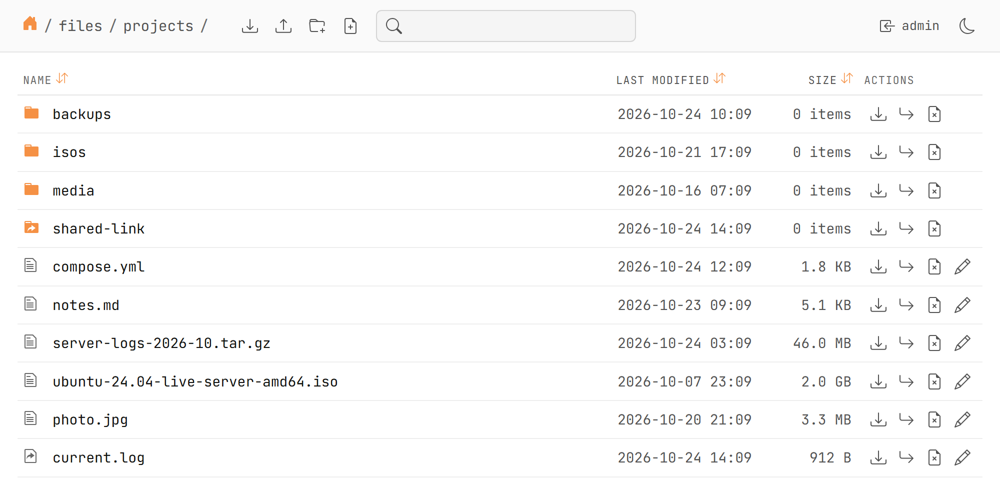

# dufs Termix theme

A light/dark theme for [dufs](https://github.com/sigoden/dufs), modelled on [Termix](https://github.com/Termix-SSH/Termix): near-black surfaces, JetBrains Mono, orange accent, and a sun/moon toggle. Built on the dufs version in [`DUFS_VERSION`](DUFS_VERSION); use that release or newer.

<p>
  
  
</p>

## Use

```bash
scripts/deploy.sh user@your-vps:/opt/dufs-theme
dufs /srv/files --assets /opt/dufs-theme -a admin:PASS@/:rw --allow-all
```

`--assets` also works as `DUFS_ASSETS` or `assets:` in the dufs config. Hard-refresh (Ctrl+Shift+R) after changes.

## Develop

- Theme: `assets/index.css` (colors are variables at the top; light palette is `:root[data-theme="light"]`).
- Your own UI: `assets/custom.js` / `custom.css`. `dufsTheme.addToolboxButton({ id, title, icon, onClick })` adds a themed top-bar button; the theme toggle is the example.
- Keep `index.js` and `favicon.ico` stock. `index.html` is stock plus three lines that load `theme-init.js`, `custom.css` and `custom.js`.

## Update dufs

```bash
scripts/update.sh              # diff the stock UI: current version -> latest release
scripts/update.sh --apply      # apply it: new index.js/favicon, rebuilt index.html, bump DUFS_VERSION
```

Pass a tag (`scripts/update.sh v0.48.0`) to pick a version. It only uses release tags: `main` can be ahead of the binary and expect server fields it doesn't send. After applying, read the diff for renamed classes that `index.css` or `custom.js` use, then try it with a local `dufs --assets assets`. On Windows run the scripts with `bash scripts/...` (Git Bash).

## License

[MIT](LICENSE). The stock dufs files (MIT OR Apache-2.0, used under MIT) and the bundled JetBrains Mono fonts (OFL 1.1) keep their own licenses, in [THIRD_PARTY_LICENSES.md](THIRD_PARTY_LICENSES.md).
